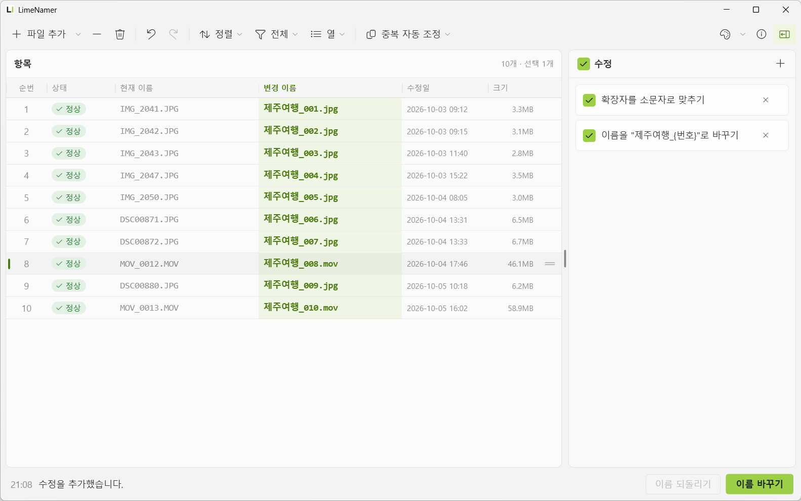
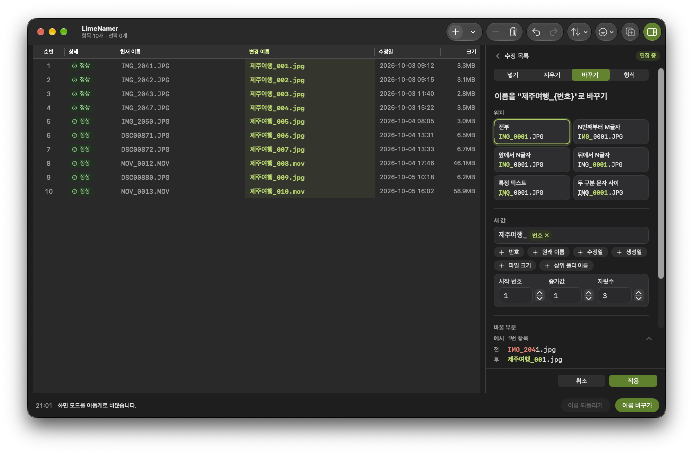

# LimeNamer

여러 파일과 폴더의 이름을 한 번에 바꾸는 프로그램이다.

**Windows**



**macOS**



## 주요 기능

- 글자 넣기, 지우기, 바꾸기와 대소문자, 자릿수 맞추기를 함께 써서 한 번에 바꾼다.
- 일련번호, 날짜 같은 파일 정보를 이름에 넣는다.
- 결과를 미리 보여 주고, 쓸 수 없거나 겹치는 이름을 알려 준다.
- 바꾼 이름을 되돌린다.

## 설치법

### Windows

#### 필요 환경

- Windows 11 이상
- .NET 데스크톱 런타임 10

런타임은 PowerShell이나 터미널에서 아래 명령으로 설치한다.

```
winget install Microsoft.DotNet.DesktopRuntime.10 --architecture x64
```

명령 대신 [.NET 10 다운로드 페이지](https://dotnet.microsoft.com/download/dotnet/10.0)에서 받아도 된다.

#### 설치

1. [릴리스](https://github.com/Limeheron/LimeNamer/releases)에서 LimeNamer-버전-win-x64.zip을 받는다.
2. 원하는 위치에 압축을 푼다. 이때 만들어지는 LimeNamer 폴더가 설치 폴더다.
3. LimeNamer 폴더의 LimeNamer.exe를 실행한다.

#### 삭제

- LimeNamer 폴더를 지운다.
- 설정은 `%LOCALAPPDATA%\LimeNamer`에 따로 남는다. 설정까지 지우려면 이 폴더도 지운다.

### macOS

#### 필요 환경

- macOS 14 이상
- Apple Silicon Mac

#### 설치

1. [릴리스](https://github.com/Limeheron/LimeNamer/releases)에서 LimeNamer-버전-mac-arm64.dmg를 받아 연다.
2. LimeNamer를 응용 프로그램 폴더로 끌어다 놓는다.
3. 처음 열 때 열 수 없다는 안내가 뜨면, 시스템 설정의 개인정보 보호 및 보안에서 "그래도 열기"를 누른다.

#### 삭제

- LimeNamer를 휴지통으로 옮긴다.
- 설정은 `~/Library/Preferences/io.github.limeheron.limenamer.plist`에 따로 남는다. 설정까지 지우려면 이 파일도 지운다.

## 사용법

1. 파일 추가 단추나 끌어 놓기로 이름을 바꿀 파일과 폴더를 넣는다.
2. 수정 패널의 + 단추를 누르고, 넣기, 지우기, 바꾸기, 형식 중 바꿀 방법을 골라 추가한다. 여러 개를 추가하면 위에 있는 것부터 적용된다.
3. 변경 이름 열에서 결과를 미리 본다. 쓸 수 없거나 겹치는 이름은 상태 열에 표시된다.
4. 이름 바꾸기를 누른다. 결과가 마음에 들지 않으면 이름 되돌리기로 되돌린다.
